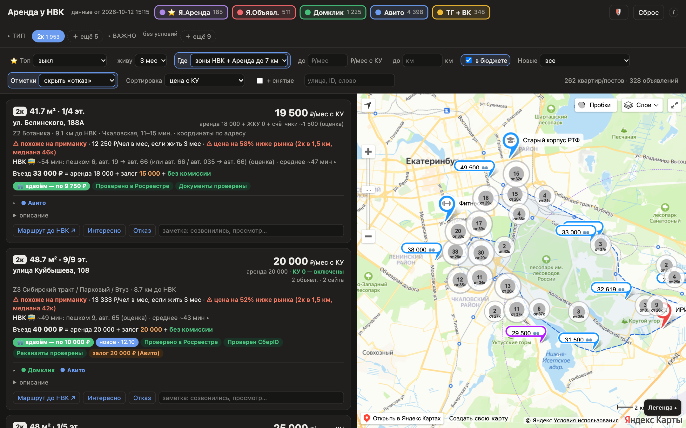
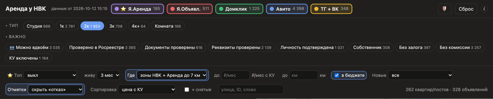
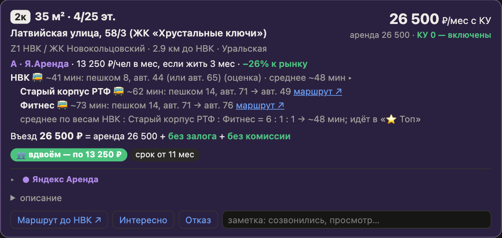
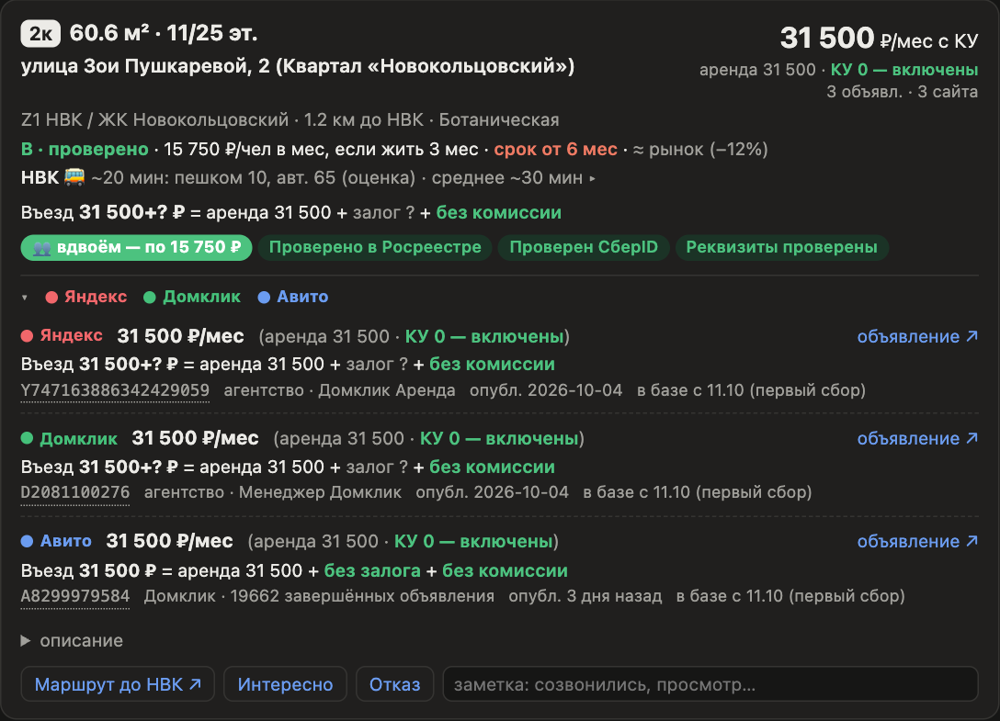
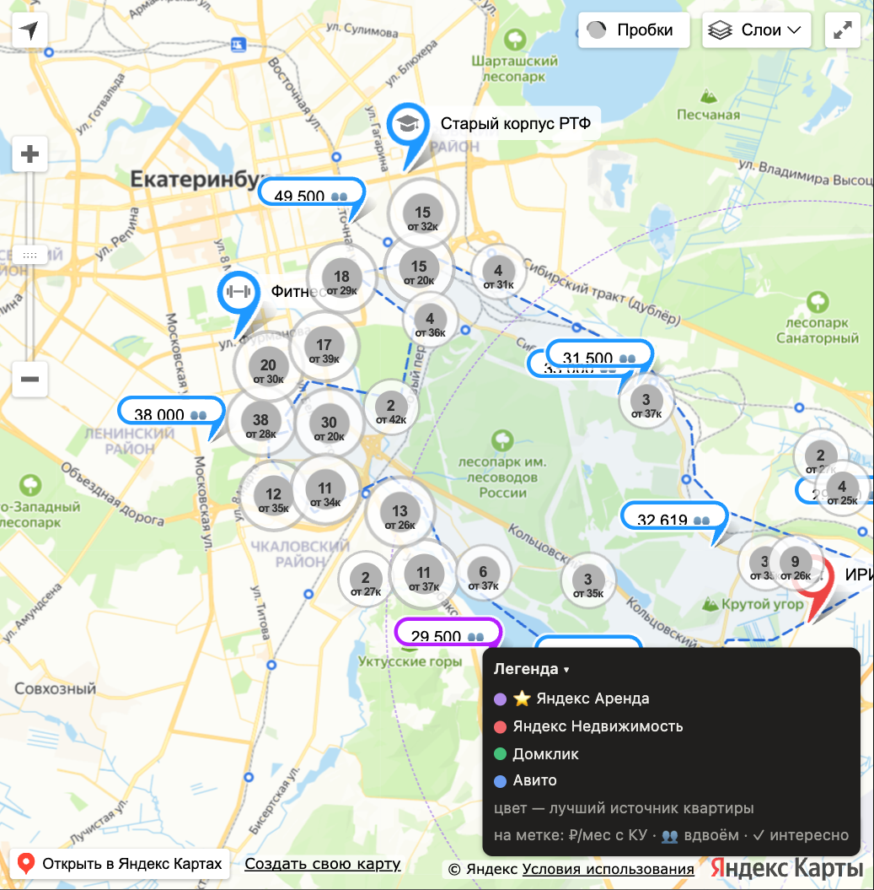
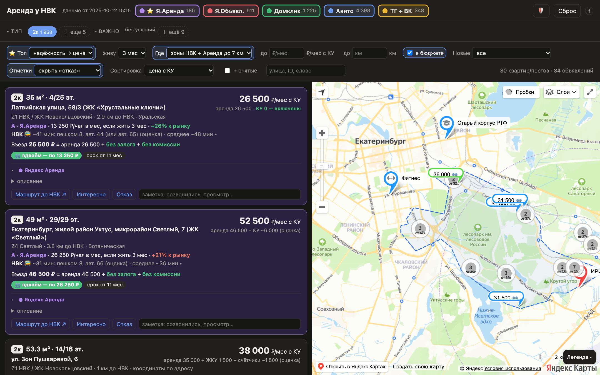
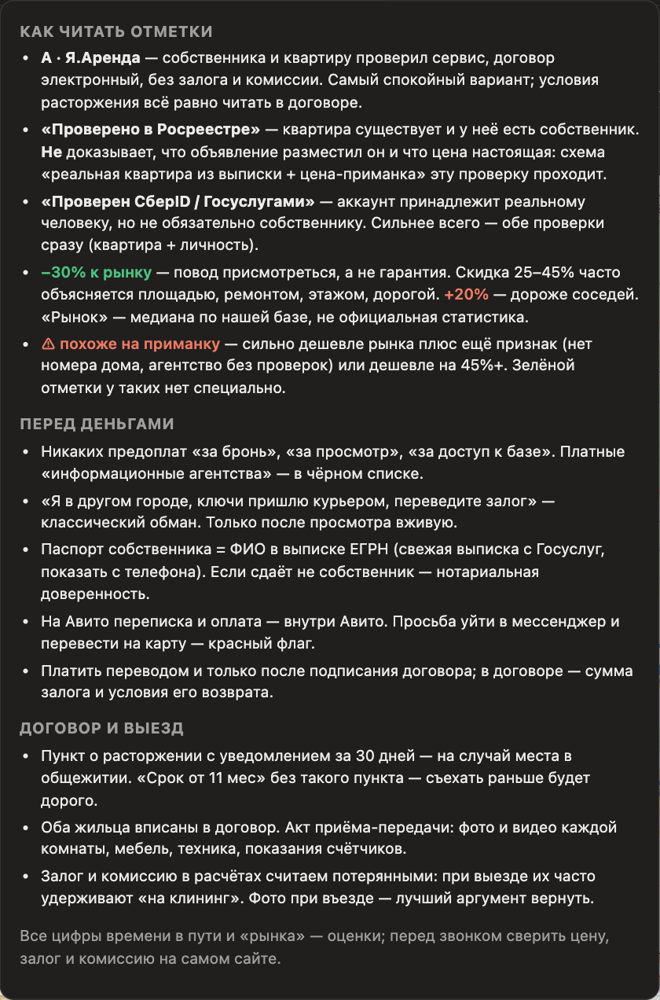

# student-ekt — аренда рядом с кампусом УрФУ «Новокольцовский» (Екатеринбург)

Личный инструмент студента, которому не дали место в общежитии. Раз в день он собирает объявления об аренде
по всему Екатеринбургу — **Яндекс Аренда, Яндекс Недвижимость, Авито, Домклик, ВК и Telegram** — и показывает их
на одной карте. Если одна квартира выложена на нескольких сайтах, объявления склеиваются в одну карточку.
Для каждой квартиры считается **реальная стоимость на человека**: аренда + КУ + залог и комиссия.
Ещё показываются время в пути до кампуса, надёжность объявления и цена относительно рынка.

**Открыть карту:** https://rapulse.github.io/student-ekt/ — обновляется после каждого сбора, телефоны в ней скрыты.



Экран состоит из трёх частей: **фильтры** сверху, **список квартир** слева и **карта** справа.
Клик по карточке показывает квартиру на карте, клик по метке на карте — её карточку в списке.

---

## 1. Источники и фильтры



**Первая строка — источники.** Каждый сайт включается и выключается отдельно, цифра рядом — сколько на нём
активных объявлений. У каждого источника свой цвет, и тот же цвет у меток на карте:

| Цвет | Источник | Чем отличается |
|---|---|---|
| 🟣 | **⭐ Яндекс Аренда** | без залога и комиссии, собственник проверен, договор электронный. Объявления Аренды, найденные на Авито, тоже попадают сюда |
| 🔴 | Яндекс Недвижимость | обычные объявления: собственники и агентства |
| 🟢 | Домклик | бывают отметки «Проверен СберID / Госуслугами» |
| 🔵 | Авито | самая большая выдача; есть отметки «Проверено в Росреестре» и «Данные подтверждены» |
| 🟡 | ТГ + ВК | посты из групп и каналов об аренде; тип и цена угадываются по тексту |

**Тип** — студия, 1к, 2к, 3к, 4к+ или комната. **Важно** — условия, которые должны выполняться все сразу:
👥 можно вдвоём, проверено в Росреестре, документы проверены, собственник, без залога, без комиссии, КУ включены и т. д.
Фильтр «Без залога/комиссии» не пропустит квартиру, если хоть один сайт пишет обратное.

**Строка с настройками:**
- **Где** — зоны вокруг кампуса (плюс Яндекс Аренда в радиусе 7 км), только полигон, весь город или всё, включая объявления без координат;
- **до ₽/мес с КУ**, **до км** — потолок цены и расстояния;
- **в бюджете** — одному до 30 000 ₽/мес с КУ, вдвоём (👥) до 60 000;
- **Новые** — объявления с прошлого запуска, за сутки, 2 дня или неделю;
- **Отметки** — скрыть «отказ» или показать только «интересно»;
- **Сортировка** — по цене с КУ, сумме на въезд, расстоянию, времени до кампуса, новизне, снижению цены, числу сайтов;
- **+ снятые** — показать объявления, которые исчезли с сайтов;
- **поиск** — по улице, ID объявления или слову из текста.

Справа — сколько квартир и объявлений прошло через фильтры. Фильтры запоминаются в браузере, кнопка **«Сброс»** вверху их очищает.

## 2. Карточка квартиры



Сверху вниз:

1. **Тип, площадь, этаж, адрес.** Справа крупно **цена в месяц с КУ**, под ней — из чего она сложилась:
   «аренда 26 500 · КУ 0 — включены» или «аренда 18 000 + счётчики ~1 500 (оценка)».
   Если сайт не указал КУ, сумма оценивается и помечается «(оценка)».
2. **Зона и расстояние до кампуса**, ближайшее метро.
3. **Надёжность и цена:**
   - уровень **A** — Яндекс Аренда, **B** — собственник или есть проверки, **C** — без проверок, **⚠ похоже на приманку**;
   - **₽ на человека в месяц, если жить N месяцев**: залог и комиссия считаются потерянными и делятся на срок;
   - **сравнение с рынком** — медиана цены соседних квартир того же типа. Зелёный — дешевле, красный — дороже.
4. **Дорога** (🚌, оценка по маршрутам общественного транспорта из OpenStreetMap). Клик по строке раскрывает время
   до второго корпуса и фитнеса и средневзвешенное время, которое учитывает «⭐ Топ».
5. **Въезд** — сколько заплатить в день заселения: аренда + залог (оранжевым) + комиссия (красным).
   «Без залога / без комиссии» — зелёным, «?» — сайт не указал.
6. **Теги:** **👥 вдвоём — по N ₽** (квартиру можно снять вдвоём, указана доля на человека), «срок от 11 мес»,
   проверки, «новое», «подешевело», расхождения между сайтами.
7. **Кнопки:** «Маршрут до НВК» (открывает Яндекс Карты), **«Интересно» / «Отказ»** и поле для заметки
   («созвонились, просмотр в пт…»).

### Одна квартира на нескольких сайтах



Если квартира выложена на нескольких сайтах, в карточке видны все её объявления
(по приоритету: Аренда → Яндекс → Домклик → Авито → посты). У каждого объявления своя цена, сумма на въезд,
ID (клик копирует), продавец, дата публикации и ссылка именно на это объявление.
Пример выше: на Яндексе и Домклике залог не указан («?»), а на Авито написано «без залога». Это повод уточнить у продавца.
Крупная цена в шапке — самая низкая цена с КУ среди всех объявлений этой квартиры.

## 3. Карта



- **Метка** — цена в месяц с КУ, 👥 — можно вдвоём, ✓ — отмечено «интересно». Цвет метки — лучший источник квартиры (см. легенду).
- **Кластер** «15 · от 32к» — сколько квартир рядом и самая низкая цена. Если все они в одном доме, клик оставляет в списке только их,
  иначе карта приближается.
- **Синий пунктир** — полигон зон: прямые автобусы до кампуса.
- **Отдельные значки** — кампус (ИРИТ-РТФ), старый корпус РТФ, фитнес.
- Сверху справа: пробки, слои и ⤢ — карта на весь экран. Внизу справа — **«Легенда»**.

## 4. «⭐ Топ» — лучшие варианты



Переключатель **«⭐ Топ»** оставляет 30 лучших квартир с учётом остальных фильтров. В Топ не попадают приманки,
квартиры дороже 30 000 ₽ на человека в месяц, с дорогой до кампуса дольше 45 минут и с минимальным сроком
от 6 месяцев (кроме Яндекс Аренды). Порядок — сначала уровень надёжности, затем полная цена на человека
плюс «штраф» 100 ₽ за каждую минуту дороги. **«живу 3 / 8 мес»** — на сколько месяцев делить залог и комиссию:
если съезжать через 3 месяца (например, дадут общежитие), они обходятся дороже.

## 5. 🛡 Безопасность



Кнопка 🛡 рядом со «Сбросом» открывает шпаргалку. В ней: как читать отметки (что на самом деле доказывает
«Проверено в Росреестре»), признаки мошенничества перед оплатой и что проверить в договоре. Главное в договоре —
пункт о расторжении с уведомлением за 30 дней, чтобы можно было съехать, когда дадут место в общежитии.

---

## Как это работает

```
Яндекс / Я.Аренда / Авито / Домклик / ВК / Telegram
        │   (Python; Авито и Домклик — через Google Chrome + puppeteer-core)
        ▼
data/listings.parquet  ── склейка дублей, реальная стоимость, зоны, история цен, снятые
        │   + transit/  (время в пути по маршрутам OSM)  + smart/ (надёжность, рынок, Топ)
        ▼
map_all.html (OpenStreetMap) · map_yandex.html (Яндекс Карты) → GitHub Pages (без телефонов)
```

### Запуск (macOS)
```bash
./rent-parser/run.sh                 # каждый день: только новое (~10–15 мин, откроется Chrome)
./rent-parser/run.sh --full          # раз в неделю: все страницы, снятые объявления, изменения цен (~1 ч)
./rent-parser/run.sh --fast          # без браузера: Яндекс + ВК/TG
open map_all.html                    # карта локально (OpenStreetMap); map_yandex.html — на Яндекс Картах
```
Нужны python3 с pandas/pyarrow, Node и `npm install` в `rent-parser/` (puppeteer-core), Google Chrome.
Ключ Яндекс Карт JS API — в `rent-parser/local_keys.json` (`{"yandex_maps_js": "…"}`, не в git).
Если сайт покажет капчу, в терминале появится подсказка: решить капчу в окне Chrome и нажать Enter.

Подробно: [`rent-parser/descr.md`](rent-parser/descr.md) (шпаргалка), [`rent-parser/TASK.md`](rent-parser/TASK.md) (решения),
[`CLAUDE.md`](CLAUDE.md) (цели и правила проекта), [`rent-parser/AGENT_TOP10.md`](rent-parser/AGENT_TOP10.md) (задание ИИ-агенту «10 лучших»).

Не в git: база `data/listings.parquet`, собранные карты, профиль Chrome, личные заметки (`_tmp/`, `CLAUDE.local.md`).
Скриншоты в `docs/screenshots/` сделаны с опубликованной карты 12.10.2026.
